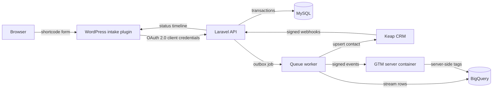

# Loanflow

**A clean-room regulated lending platform built to demonstrate the exact stack in a senior full-stack lending brief: PHP 8.x / Laravel, MySQL, JavaScript, OAuth 2.0, Keap CRM, WordPress, BigQuery and Google Tag Manager.**

[](https://github.com/itsoumya-d/loanflow/actions/workflows/ci.yml)
[](https://www.php.net/)
[](https://laravel.com/)
[](LICENSE)

> This is an independent, clean-room reference implementation. It is not affiliated with, endorsed by, or copied from Loansmart. No proprietary code, copy, branding, customer data or internal systems were used. The only inputs were the public job description and public product pages, plus general lending-domain requirements.

---

## Why this exists

The target role asks for a senior engineer who can own a PHP/MySQL portal, build lender and CRM integrations, harden a regulated environment, bring delivery in-house with Git and CI/CD, and use AI-assisted development without losing engineering judgement.

Loanflow is a working, tested answer to that brief:

- A **Laravel 13 / PHP 8.x API** with a real application state machine, validation and idempotency.
- A **WordPress intake plugin** written in vanilla JavaScript, with OAuth 2.0, nonce verification, honeypot and rate limiting.
- **Keap CRM** contact upsert, token refresh, retries and signed webhook ingestion.
- **BigQuery** streaming exports with service-account JWT authentication.
- **Google Tag Manager** dataLayer events, a custom template and signed server-side forwarding.
- **Security and compliance** controls: OWASP secure-coding practice, RBAC, encrypted PII, hash-chained audit logs, HMAC webhooks, metrics and a threat model.
- **CI/CD** on GitHub Actions across PHP 8.3–8.5, MySQL 8, Node 20–24, plus a production Docker stack.

## Stack

| Layer | Technology |
| --- | --- |
| API | PHP 8.3–8.5, Laravel 13, Laravel Passport |
| Database | MySQL 8 in CI and production; SQLite for local tests |
| Frontend intake | WordPress 6.4+, vanilla JavaScript, accessible HTML/CSS |
| CRM | Keap / Infusionsoft REST v2, OAuth 2.0 |
| Analytics | BigQuery streaming inserts, Google Tag Manager dataLayer and server-side tagging |
| Queue | Laravel database queue (Redis-ready) |
| Quality | PHPUnit 12, Pint, PHPStan/Larastan level 5, Node test runner |
| Delivery | GitHub Actions, Docker, Docker Compose, nginx + PHP-FPM |

## Architecture



### Submission flow

1. The WordPress form validates locally, then POSTs to the plugin's REST route with a nonce.
2. The plugin validates again, enforces a per-IP limit, obtains an OAuth 2.0 token and calls `POST /api/v1/loan-applications` with an `Idempotency-Key`.
3. Laravel validates the payload, creates the application and a hash-chained `loan_application.received` event, writes an audit record, and dispatches `ProcessLoanApplication` after commit.
4. The queue worker upserts the contact in Keap, streams unexported events to BigQuery, and forwards events to the GTM server container.
5. Keap status webhooks are signature-verified, stored as receipts, deduplicated by event ID, and applied through the same state machine.
6. Every state change is appended to the event timeline and audit chain.

## API

| Method | Path | Auth | Purpose |
| --- | --- | --- | --- |
| `POST` | `/oauth/token` | OAuth 2.0 | Client credentials or authorization code token |
| `POST` | `/api/v1/loan-applications` | `client:applications:write` | Create an application (idempotent) |
| `GET` | `/api/v1/loan-applications/{reference}` | `applications:read` | Read an application |
| `GET` | `/api/v1/loan-applications/{reference}/timeline` | `applications:read` | Read the event timeline |
| `PATCH` | `/api/v1/loan-applications/{reference}/status` | `applications:manage` | Move the application through the state machine |
| `GET` | `/api/v1/machine/loan-applications/{reference}` | `client:applications:read` | Machine-to-machine read |
| `POST` | `/api/v1/webhooks/keap` | HMAC | Keap webhook receiver |
| `POST` | `/api/v1/events/gtm` | HMAC | GTM server-side event ingest |
| `GET` | `/api/v1/health` | Public | Database and cache health |
| `GET` | `/api/v1/metrics` | Bearer token | Prometheus text metrics |

### Example

```bash
TOKEN=$(curl -s -X POST http://localhost:8000/oauth/token \
  -d grant_type=client_credentials \
  -d client_id="$CLIENT_ID" \
  -d client_secret="$CLIENT_SECRET" \
  -d scope="applications:write applications:read" | jq -r .access_token)

curl -X POST http://localhost:8000/api/v1/loan-applications \
  -H "Authorization: Bearer $TOKEN" \
  -H "Content-Type: application/json" \
  -H "Idempotency-Key: 5f0c2c1e-9a4d-4a9e-9f0e-2b6a7c8d9e10" \
  -d '{
    "applicant_name": "Jane Doe",
    "email": "jane@example.com",
    "phone": "+64211234567",
    "loan_amount_cents": 2500000,
    "loan_purpose": "vehicle",
    "employment_status": "employed",
    "annual_income_cents": 9500000,
    "credit_check_consent": true,
    "privacy_consent": true
  }'
```

## Quickstart

```bash
cp .env.example .env
composer install
php artisan key:generate
php artisan passport:keys
touch database/database.sqlite
php artisan migrate --seed
php artisan serve
```

The seeder creates a demo OAuth client and prints its one-time secret. For a clean client:

```bash
php artisan loanflow:client "WordPress intake"
```

### Docker

```bash
cp .env.example .env
docker compose up -d --build
docker compose exec app php artisan migrate --force
open http://localhost:8080
```

## WordPress plugin

`wordpress/loanflow-intake` provides:

- `[loanflow_application_form]` shortcode.
- Accessible form markup with 44px targets, focus-visible styles and reduced-motion support.
- Client-side validation plus server-side re-validation.
- Nonce verification, honeypot and per-IP throttling.
- OAuth 2.0 token caching and one retry on `401`.
- Consent-aware GTM events with no PII.

Install by copying the folder into `wp-content/plugins/`, activating it, then configuring Settings → Loanflow Intake.

## Google Tag Manager and BigQuery

- `gtm/datalayer.mjs` defines the consent-aware event contract.
- `gtm/templates/loanflow_event.tpl` is an importable GTM custom template that forwards events to a server container.
- `gtm/README.md` documents the web → server container → Laravel hop.
- `config/loanflow.php` and `docs/bigquery-schema.json` define the BigQuery project, dataset, table and row shape.
- `ServiceAccountAccessTokenProvider` signs a Google JWT and exchanges it for an access token; tests generate a throwaway RSA key.

## Keap CRM

- `KeapTokenProvider` supports refresh-token and client-credentials grants with token caching.
- `KeapClient` finds a contact by email, then creates or updates it, with retry/backoff on `429` and `5xx`.
- `KeapWebhookVerifier` verifies `X-Keap-Signature` with HMAC-SHA256 and a timing-safe comparison.
- `KeapWebhookProcessor` resolves the application by contact ID or loan reference, records the event and applies the status transition.
- Webhook receipts are unique per `(provider, event_id)` for replay safety.

## Security

See `docs/threat-model.md` for the full STRIDE model. Controls include:

- OAuth 2.0 scopes, Passport token expiry and refresh-token expiry.
- RBAC for decision endpoints (`admin`, `loan_officer`, `viewer`).
- Idempotency keys and conflict detection.
- Encrypted phone numbers, hashed email lookup, PII minimisation.
- HMAC-signed webhooks and GTM ingest.
- Per-tenant and per-IP rate limits.
- Hash-chained events and audit logs with tamper-detection tests.
- Security headers, health checks and Prometheus metrics.
- No PII in GTM events; consent defaults to denied.

## Quality

```bash
vendor/bin/pint --test
vendor/bin/phpstan analyse --no-progress --memory-limit=1G
php artisan test
npm run test:gtm
```

Current local result: **53 PHP tests / 150 assertions passing**, **6 Node tests passing**, Pint clean and PHPStan level 5 clean.

CI runs the PHP suite on 8.3, 8.4 and 8.5; the feature suite against MySQL 8; the GTM suite on Node 20, 22 and 24; and `php -l` across the WordPress plugin.

## Evidence and research

- `docs/evidence-matrix.md` maps every brief requirement to code and tests.
- `docs/architecture.md` explains the state machine, outbox and hash chain.
- `docs/threat-model.md` lists assets, trust boundaries and residual risks.
- `docs/research/` contains the clean-room recon, REA notes, reverse-skill security review and Entrepreneur review analysis.
- `replica/` contains the adapted recon, feature matrix and fix plan used to shape the product.

## Limitations

- External integrations are implemented against documented APIs but are not run against live Keap, BigQuery or GTM credentials in CI.
- The WordPress plugin is tested with Brain Monkey, not a full WordPress test suite.
- Bank-statement retrieval, SMS and AI-calling adapters are out of scope for this reference build; the integration boundaries and threat model document where they belong.
- No production SLA, WAF, KMS key rotation or WORM audit storage is claimed.

## License

MIT © 2026 Soumya Debnath
