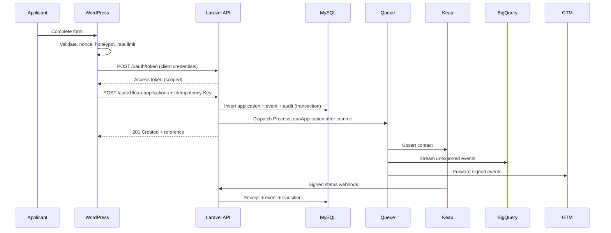
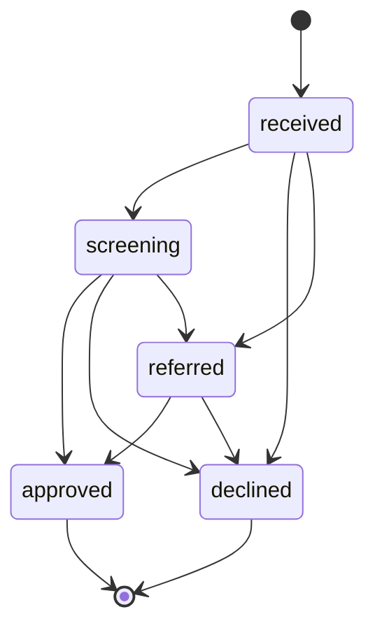

# Architecture

## Context

Loanflow is a clean-room reference implementation of a regulated lending intake and integration platform. It is deliberately small enough to audit, but complete enough to show the engineering shape a senior full-stack lead would own: a PHP/MySQL portal, partner integrations, security controls, CI/CD, analytics and a WordPress intake surface.

## Components

| Component | Responsibility |
| --- | --- |
| Laravel API | Validation, state machine, OAuth 2.0 resource server, webhooks, timeline, metrics |
| MySQL | Applications, events, audit logs, webhook receipts, integration deliveries, OAuth tables |
| Queue worker | Keap upsert, BigQuery export, GTM forwarding, outbox retries |
| WordPress plugin | Accessible intake form, nonce and rate-limit checks, OAuth token cache, REST proxy |
| Keap CRM | Contact system of record for sales and loan status |
| BigQuery | Analytics warehouse for event-level reporting |
| GTM server container | Server-side tagging and consent-aware measurement |
| GitHub Actions | PHP matrix, MySQL integration, Node tests, plugin lint |
| Docker Compose | PHP-FPM, nginx, queue worker, MySQL 8, Redis 7 |

## Request flow



## State machine



Invalid transitions return `422` and are not persisted. Terminal states cannot be reopened; a new application is required. This is deliberate: regulated decisions need an auditable, one-way record.

## Idempotency

- The API requires an `Idempotency-Key` header of 8–128 characters.
- The key is unique in `loan_applications`.
- The request payload is hashed (SHA-256, canonical JSON).
- Replaying the same key and payload returns `200` with the existing application.
- Replaying the same key with a different payload returns `409`.
- The key is stored with the application and excluded from API responses.

## Outbox and delivery

The first implementation uses the database as an outbox:

1. Domain events are written in the same transaction as the application.
2. `ProcessLoanApplication` is dispatched after commit.
3. The job upserts Keap, exports unexported events to BigQuery and forwards unforwarded events to GTM.
4. Each destination marks its own timestamp (`bigquery_exported_at`, `gtm_forwarded_at`).
5. `loanflow:outbox` re-dispatches applications with pending events every minute.
6. Delivery failures are audit-logged and do not roll back the applicant submission.

This keeps the applicant path fast and makes downstream failure recoverable. A production deployment should replace the database queue with Redis/SQS and add a dead-letter queue.

## Hash chains

Every domain event stores `previous_hash` and `hash`:

```text
hash = SHA-256(previous_hash | canonical_json({
  loan_application_id, type, payload, occurred_at
}))
```

`LoanEventService::verifyChain()` recomputes the chain. `AuditLogger::verifyChain()` does the same for audit records. Tests tamper with a stored row and assert verification fails.

This is tamper-evident, not tamper-proof. Production should anchor the latest hash in WORM storage or an external transparency log.

## Security boundaries

- Browser → WordPress: nonce, honeypot, per-IP throttle, server-side validation.
- WordPress → Laravel: OAuth 2.0 client credentials, scoped access token, idempotency key.
- Laravel → Keap: OAuth 2.0 token, retries, timeout, no secret logging.
- Keap → Laravel: HMAC-SHA256 signature, replay receipt, state-machine validation.
- Laravel → BigQuery: service-account JWT, least-privilege BigQuery insert scope.
- Laravel → GTM: HMAC-signed event, no PII, consent defaults denied.

## Scaling notes

- Reads are indexed by `reference`, `status`, `submitted_at`, `email_hash` and `keap_contact_id`.
- The queue worker is horizontally scalable; delivery timestamps make work idempotent per destination.
- Rate limits are currently application-level. A multi-instance deployment should move them to Redis.
- BigQuery inserts are streamed per event; batching can be added behind the same exporter interface.
- The GTM forwarder is a singleton; if event volume grows, use a dedicated outbox table with per-destination workers.

## Non-goals

- Credit decisioning or affordability modelling.
- Bank-statement retrieval, SMS delivery and AI calling (integration boundaries are documented, not implemented).
- A full loan servicing ledger; `go-ledger` is the separate financial-primitives proof.
- A production WordPress theme or page builder integration.
